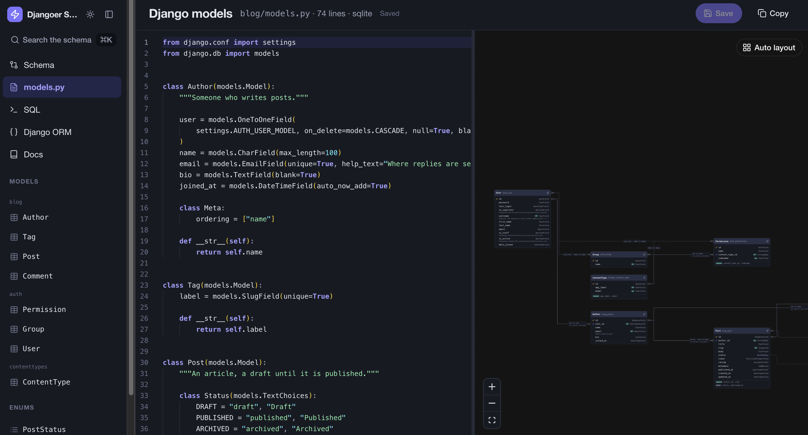

# Djangoer

A Studio for your Django project: its models and its database in the browser.



- **Edit models.py** beside the ER diagram, which follows the text as you type
- **Browse the rows** of each model: search, add, edit, delete, export
- **Run SQL** and **try ORM queries**, and see the SQL each one sends
- **Write the schema out** as Mermaid, DBML, SVG, PNG or Markdown docs

## Install

```bash
pip install djangoer
```

## Use

Beside `manage.py`:

```bash
djangoer studio            # http://127.0.0.1:5555
```

```bash
djangoer er -o er.md -o schema.dbml -o er.svg
djangoer docs -o docs/schema
```

More in the package's README: [packages/djangoer/README.md](packages/djangoer/README.md).
Working on Djangoer itself: [CONTRIBUTING.md](CONTRIBUTING.md).

## License

MIT
