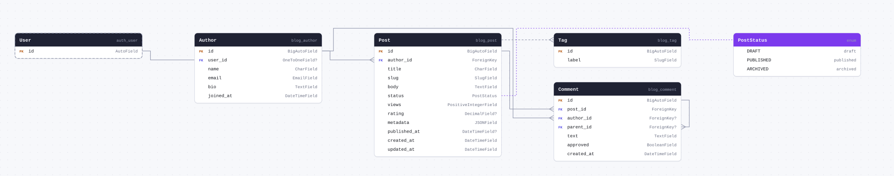

# Schema docs



[Author](#author) · [Tag](#tag) · [Post](#post) · [Comment](#comment)

<details>
<summary>The whole schema as SQL</summary>

```sql
CREATE TABLE "blog_author" ("id" integer NOT NULL PRIMARY KEY AUTOINCREMENT, "user_id" integer NULL UNIQUE REFERENCES "auth_user" ("id") DEFERRABLE INITIALLY DEFERRED, "name" varchar(100) NOT NULL, "email" varchar(254) NOT NULL UNIQUE, "bio" text NOT NULL, "joined_at" datetime NOT NULL);

CREATE TABLE "blog_tag" ("id" integer NOT NULL PRIMARY KEY AUTOINCREMENT, "label" varchar(50) NOT NULL UNIQUE);

CREATE TABLE "blog_post" ("id" integer NOT NULL PRIMARY KEY AUTOINCREMENT, "author_id" bigint NOT NULL REFERENCES "blog_author" ("id") DEFERRABLE INITIALLY DEFERRED, "title" varchar(200) NOT NULL, "slug" varchar(200) NOT NULL, "body" text NOT NULL, "status" varchar(10) NOT NULL, "views" integer unsigned NOT NULL CHECK ("views" >= 0), "rating" decimal NULL, "metadata" text NOT NULL CHECK ((JSON_VALID("metadata") OR "metadata" IS NULL)), "published_at" datetime NULL, "created_at" datetime NOT NULL, "updated_at" datetime NOT NULL, CONSTRAINT "post_author_slug_unique" UNIQUE ("author_id", "slug"));

CREATE TABLE "blog_post_tags" ("id" integer NOT NULL PRIMARY KEY AUTOINCREMENT, "post_id" bigint NOT NULL REFERENCES "blog_post" ("id") DEFERRABLE INITIALLY DEFERRED, "tag_id" bigint NOT NULL REFERENCES "blog_tag" ("id") DEFERRABLE INITIALLY DEFERRED);

CREATE TABLE "blog_comment" ("id" integer NOT NULL PRIMARY KEY AUTOINCREMENT, "post_id" bigint NOT NULL REFERENCES "blog_post" ("id") DEFERRABLE INITIALLY DEFERRED, "author_id" bigint NULL REFERENCES "blog_author" ("id") DEFERRABLE INITIALLY DEFERRED, "parent_id" bigint NULL REFERENCES "blog_comment" ("id") DEFERRABLE INITIALLY DEFERRED, "text" text NOT NULL, "approved" bool NOT NULL, "created_at" datetime NOT NULL);
```

</details>

## Author

Table `blog_author`, app `blog`.

Someone who writes posts.

| Column | Field | Type | Null | Key | Default | Description |
| --- | --- | --- | --- | --- | --- | --- |
| `id` | `BigAutoField` | `integer` |  | PK | `autoincrement()` |  |
| `user_id` | `OneToOneField` | `integer` | yes | FK, unique |  |  |
| `name` | `CharField` | `varchar(100)` |  |  |  |  |
| `email` | `EmailField` | `varchar(254)` |  | unique |  | Where replies are sent |
| `bio` | `TextField` | `text` |  |  |  |  |
| `joined_at` | `DateTimeField` | `datetime` |  |  | `now()` |  |

Relations:

- [Post](#post).`author_id` → `id`, on delete cascade
- [Comment](#comment).`author_id` → `id`, on delete set null

## Tag

Table `blog_tag`, app `blog`.

| Column | Field | Type | Null | Key | Default | Description |
| --- | --- | --- | --- | --- | --- | --- |
| `id` | `BigAutoField` | `integer` |  | PK | `autoincrement()` |  |
| `label` | `SlugField` | `varchar(50)` |  | unique |  |  |

Relations:

- `posts` — many to many with [Post](#post)

## Post

Table `blog_post`, app `blog`.

An article, a draft until it is published.

| Column | Field | Type | Null | Key | Default | Description |
| --- | --- | --- | --- | --- | --- | --- |
| `id` | `BigAutoField` | `integer` |  | PK | `autoincrement()` |  |
| `author_id` | `ForeignKey` | `bigint` |  | FK |  |  |
| `title` | `CharField` | `varchar(200)` |  |  |  |  |
| `slug` | `SlugField` | `varchar(200)` |  |  |  |  |
| `body` | `TextField` | `text` |  |  |  |  |
| `status` | `PostStatus` | `varchar(10)` |  |  | `'draft'` |  |
| `views` | `PositiveIntegerField` | `integer unsigned` |  |  | `0` |  |
| `rating` | `DecimalField` | `decimal` | yes |  |  |  |
| `metadata` | `JSONField` | `text` |  |  | `dict()` |  |
| `published_at` | `DateTimeField` | `datetime` | yes |  |  |  |
| `created_at` | `DateTimeField` | `datetime` |  |  | `now()` |  |
| `updated_at` | `DateTimeField` | `datetime` |  |  | `now()` |  |

Indexes:

- unique `post_author_slug_unique` on `author_id`, `slug`
- index `post_status_published` on `status`, `published_at`

Relations:

- `author_id` → [Author](#author).`id`, on delete cascade
- `tags` — many to many with [Tag](#tag)
- [Comment](#comment).`post_id` → `id`, on delete cascade

## Comment

Table `blog_comment`, app `blog`.

| Column | Field | Type | Null | Key | Default | Description |
| --- | --- | --- | --- | --- | --- | --- |
| `id` | `BigAutoField` | `integer` |  | PK | `autoincrement()` |  |
| `post_id` | `ForeignKey` | `bigint` |  | FK |  |  |
| `author_id` | `ForeignKey` | `bigint` | yes | FK |  |  |
| `parent_id` | `ForeignKey` | `bigint` | yes | FK |  |  |
| `text` | `TextField` | `text` |  |  |  |  |
| `approved` | `BooleanField` | `bool` |  |  | `False` |  |
| `created_at` | `DateTimeField` | `datetime` |  |  | `now()` |  |

Relations:

- `post_id` → [Post](#post).`id`, on delete cascade
- `author_id` → [Author](#author).`id`, on delete set null
- `parent_id` → [Comment](#comment).`id`, on delete cascade

# Enums

## PostStatus

| Name | Stored as |
| --- | --- |
| `DRAFT` | `draft` |
| `PUBLISHED` | `published` |
| `ARCHIVED` | `archived` |
