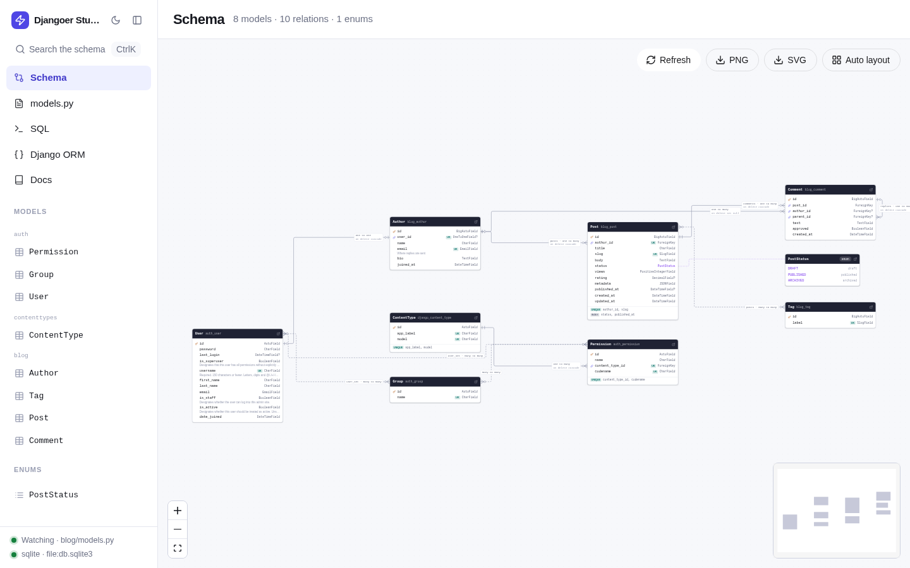
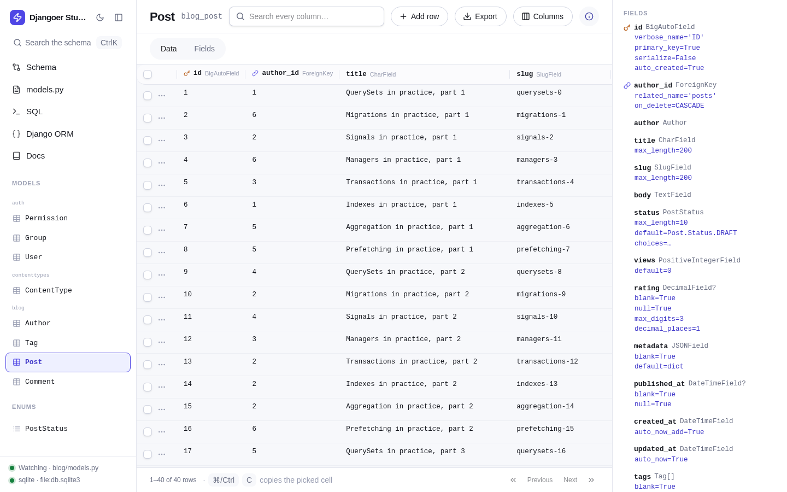
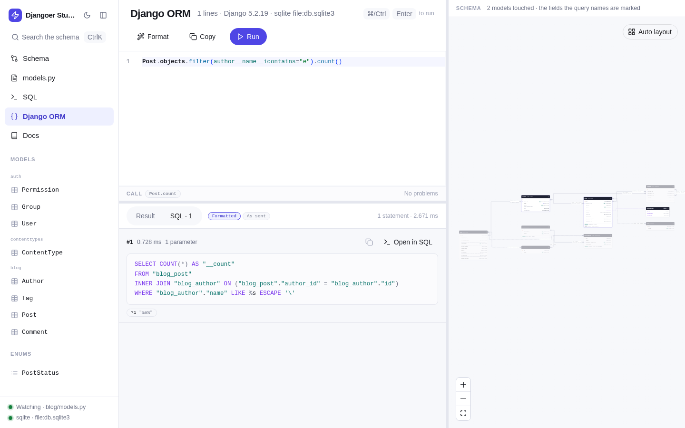
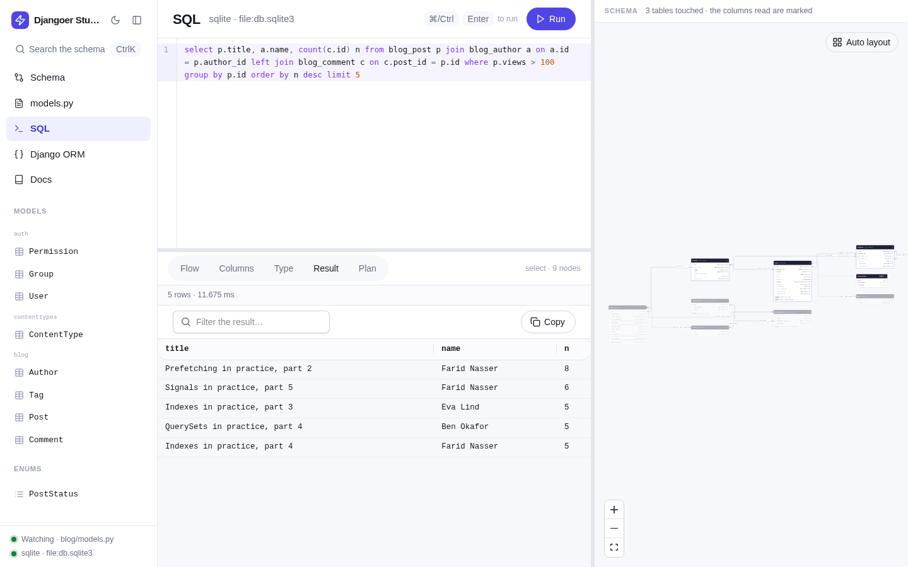
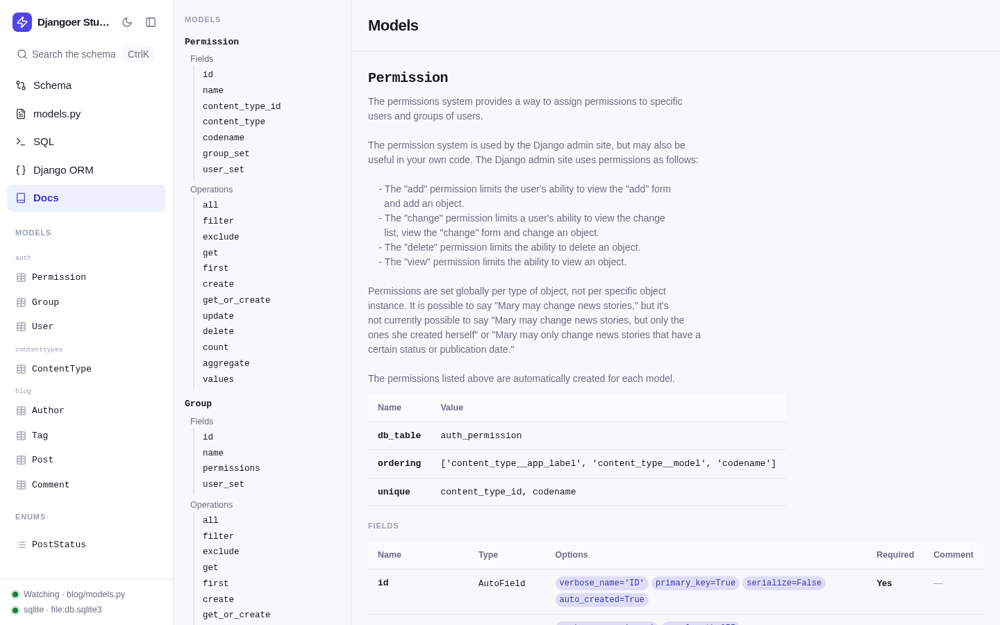

# Djangoer

**[Djangoer](https://pypi.org/project/djangoer/)** is a Studio for a [Django](https://www.djangoproject.com/)
project: its models and its database in the browser. Browse the rows, run SQL, try ORM queries
and see the SQL each one sends.

## Installation

```bash
pip install djangoer
```

It works with Django 4.2 or later. The Studio client ships built inside the package: there is
no Node.js to install. The server is [FastAPI](https://fastapi.tiangolo.com/) on
[uvicorn](https://www.uvicorn.org/), so those come with it, along with
[Pydantic](https://docs.pydantic.dev/) and [returns](https://returns.readthedocs.io/). Install
it as a development dependency, in the environment the project itself runs in:

```bash
uv add --dev djangoer
uv run djangoer studio
```

## Studio

Beside `manage.py`:

```bash
djangoer studio
```

Studio reads the settings module `manage.py` names, else `$DJANGO_SETTINGS_MODULE`, and listens
on <http://127.0.0.1:5555>. It restarts when the project's code changes, as `runserver` does.

```bash
djangoer studio --settings mysite.settings --port 8001 --database replica --open
```

With `"djangoer"` in `INSTALLED_APPS` it is a management command as well:

```bash
python manage.py studio
```

**See the schema**: every model as an ER diagram, grouped by app, with its fields, its indexes
and the `on_delete` of each relation.



**Browse the rows** of each model: search, add, edit, delete and export them. A delete goes
through the ORM, so `on_delete` is honoured.



**Try ORM queries**, with completion that follows the chain: models, QuerySet methods, fields,
`author__name__` lookups across relations. The diagram marks the models and fields a query
names, and the SQL tab shows every statement it sent with its parameters.



```python
author = Author.objects.get(email="ann@example.com")
author.posts.filter(status="published").annotate(n=Count("comments")).order_by("-n")[:5]
```

A query may be several statements; the value of the last expression is the result. Models,
`Q`, `F`, the aggregates and database functions, `timezone`, `datetime`, `Decimal` are in scope,
and `blog.Post` names a model through its app.

**Run SQL** against the database. The statement is drawn as a flow, the tables and columns it
reads are marked on the diagram, and the rows it returns are typed from the models as a
`TypedDict`.



**Read models.py** beside the diagram. Studio follows the file: save it, and the page and the
diagram show the change a moment later. Save it half-written, and Studio says where it stopped
loading and waits for the fix.

**Read the docs** of every model: its fields, and an example of each ORM operation. _Try it_
opens the example in the playground, where a read runs as it arrives.



## What it runs, and where

Studio is a development tool. It runs in your project's own process, with the settings and the
database you start it with, so point it at a database you may change.

- It listens on `127.0.0.1` and answers only requests addressed to it. `--host 0.0.0.0` gives
  everyone who can reach the port the same access you have.
- An ORM query is the project's own code path, as powerful as `manage.py shell`. Before it runs,
  its syntax tree is checked: no `import`, no `def`, no `while`, no names starting with an
  underscore. These are rails against a typo, not a sandbox.
- The SQL of a query is previewed as you type only when the query can do nothing but read. A
  write, or a call to a method of your own, runs when you press Run, in one transaction.

## The API

Everything Studio shows comes from a JSON API under `/api`, described by an OpenAPI document
the server writes from its own models: `/api/openapi.json`, and `/api/reference` to browse it.

## Databases

SQLite, PostgreSQL and MySQL (MariaDB), through whatever `DATABASES` configures. Other backends
get everything except the query plan.

## License

MIT. See [LICENSE](https://github.com/nakita628/djangoer?tab=MIT-1-ov-file).
